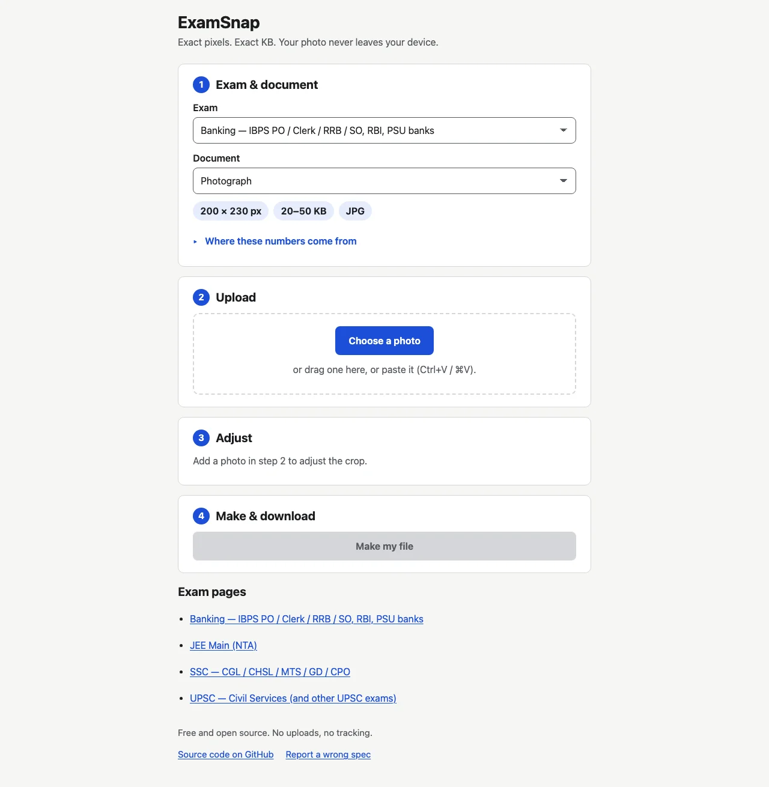
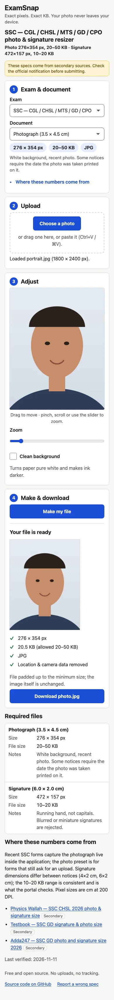

# ExamSnap

Turn a photo or signature into a JPEG with the exact pixel size and KB range Indian exam portals require. Everything runs in your browser and nothing is uploaded.

**Live:** https://examsnap.asifurrahaman.com/

Works offline after your first visit, and you can install it from your browser menu ("Install app" / "Add to Home Screen").

  
  

## Supported exams

<!-- exams:start -->
| Exam | Documents | Source |
| --- | --- | --- |
| [Banking — IBPS PO / Clerk / RRB / SO, RBI, PSU banks](https://examsnap.asifurrahaman.com/banking-ibps/) | Photograph: 200×230 px, 20–50 KB Signature: 140×60 px, 10–20 KB Left thumb impression: 240×240 px, 20–50 KB Handwritten declaration: 800×400 px, 50–100 KB | Official notice |
| [JEE Main (NTA)](https://examsnap.asifurrahaman.com/jee-main/) | Photograph (3.5 × 4.5 cm): 276×354 px, 10–200 KB Signature (3.5 × 1.5 cm): 276×118 px, 10–30 KB | [⚠ Needs verification](https://github.com/GeekyAsif786/ExamSnap/labels/verify-preset) |
| [SSC — CGL / CHSL / MTS / GD / CPO](https://examsnap.asifurrahaman.com/ssc/) | Photograph (3.5 × 4.5 cm): 276×354 px, 20–50 KB Signature (6.0 × 2.0 cm): 472×157 px, 10–20 KB | [⚠ Needs verification](https://github.com/GeekyAsif786/ExamSnap/labels/verify-preset) |
| [UPSC — Civil Services (and other UPSC exams)](https://examsnap.asifurrahaman.com/upsc-cse/) | Photograph: 400×500 px, 20–200 KB Signature ×3 (one image): 500×350 px, 20–100 KB Photo ID card: 800×500 px, 20–200 KB | [⚠ Needs verification](https://github.com/GeekyAsif786/ExamSnap/labels/verify-preset) |
<!-- exams:end -->

Your exam missing? [Request it](https://github.com/GeekyAsif786/ExamSnap/issues/new?template=request-exam.yml&title=%5BExam%5D%20) · [Add it yourself in 10 minutes](CONTRIBUTING.md#add-an-exam-in-10-minutes)

## Security & privacy

- Your photo never leaves your device: all processing happens in the browser, and nothing is uploaded.
- No analytics, no tracking, no third-party requests. A strict Content-Security-Policy (`default-src 'none'`, scripts and styles from the site only) is on every page, and the app refuses to run inside another site's frame.
- Output JPEGs carry no EXIF, XMP, IPTC or comment metadata.
- Found a security problem? Please report it privately; see [SECURITY.md](SECURITY.md).

## Contributors

Thank you to everyone who has added an exam, checked a spec or fixed a bug. New here? Start with [CONTRIBUTING.md](CONTRIBUTING.md).

## Licensing

- Code: [AGPL-3.0-or-later](LICENSE)
- Presets (`presets/`): [CC0-1.0](presets/LICENSE)

The ExamSnap name and logo are not covered by these licenses.

## Development

- `npm install` — install dev dependencies.
- `npx playwright install --with-deps` — install the browsers for end-to-end tests.
- `npm run dev` — serve the app at http://localhost:5173/.
- `npm test` — run the unit tests.
- `npm run build` — build the site into `dist/`.
- `npm run preview` — build, then serve `dist/` at http://localhost:4173/.
- `npm run test:e2e` — run the Playwright tests on Chromium, Firefox and WebKit against the built site.
- `npm run check` — validate presets, regenerate the presets module, check the README exams table is fresh (a warning on pull requests, an error locally and on main), and enforce the JS size budget.

`src/generated/presets.js` is not committed: npm regenerates it from `presets/` before `dev`, `preview`, `build`, `test`, `test:e2e`, `screenshots` and `check`.
- `npm run new-preset` — add an exam preset interactively (see [CONTRIBUTING.md](CONTRIBUTING.md)).
- `npm run update-readme` — regenerate the README "Supported exams" table from `presets/`.
- `npm run labels` — show how GitHub labels differ from `.github/labels.yml`; `npm run labels -- --apply` syncs them (maintainer only, needs `gh`).
- `npm run screenshots` — capture review screenshots of the built site into `screenshots/` (gitignored; CI attaches them to every PR). Add `-- --readme` to refresh the two README images in `docs/screenshots/`.
- `npm run icons` — regenerate the app icons and social image in `icons/`.

## Deployment

Every push to `main` runs lint, check and unit tests, builds, and deploys `dist/` to GitHub Pages (`.github/workflows/deploy.yml`).

The build reads two environment variables:

- `BASE_PATH` — URL prefix the site lives under. Default `/`.
- `SITE_ORIGIN` — origin used for canonical, sitemap and social URLs. Default `https://examsnap.asifurrahaman.com`.

The site is served from the custom domain set in Settings → Pages (Actions-based deploys need no `CNAME` file). To serve it somewhere else, set the repository variables `BASE_PATH` and `SITE_ORIGIN` (Settings → Secrets and variables → Actions → Variables) and re-run the deploy; for example `BASE_PATH=/ExamSnap/` and `SITE_ORIGIN=https://geekyasif786.github.io` for the project-site URL.
